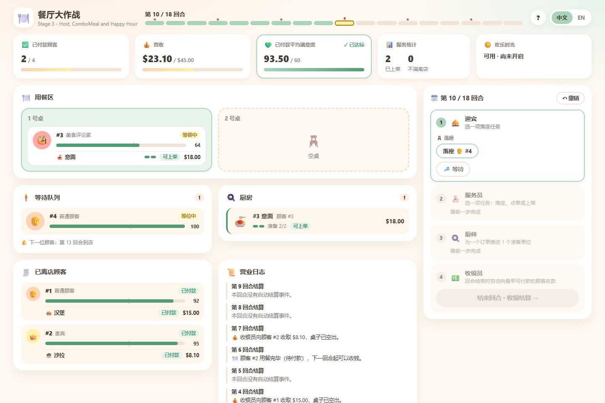
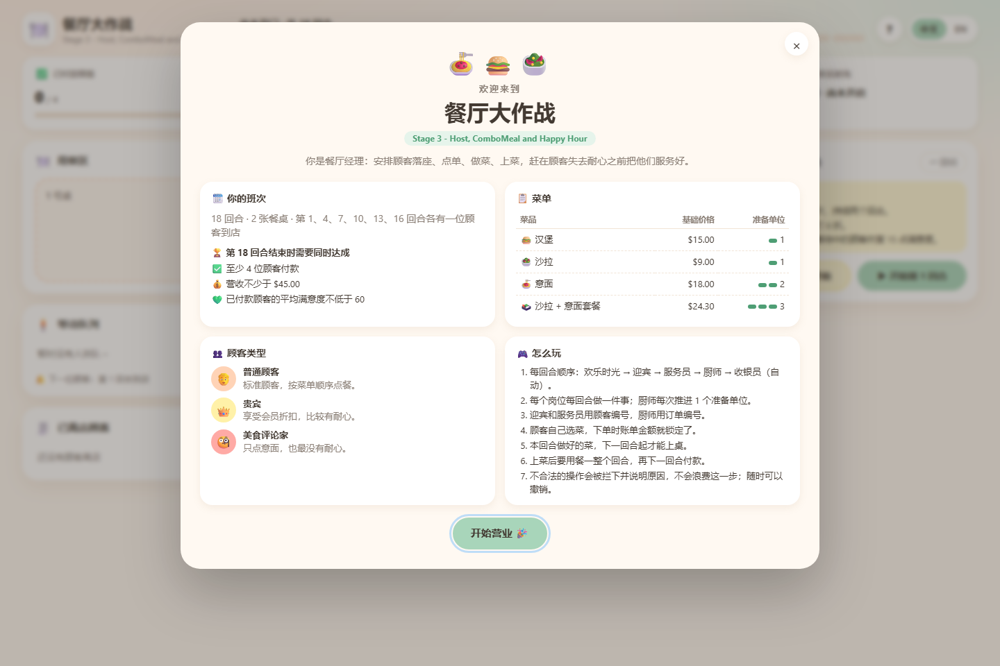

<h1 align="center">🍽️ Restaurant Rush</h1>

<p align="center">
A turn-based restaurant management game in Java · SC2002 Object-Oriented Design &amp; Programming
</p>

<p align="center">
English below · <a href="https://zhangxiaozhuang398-max.github.io/SC2002-Object-Oriented-Design-and-Programming/?lang=zh"><b>中文版 / 一键切换中英</b></a> · <a href="https://zhangxiaozhuang398-max.github.io/SC2002-Object-Oriented-Design-and-Programming/">documentation site</a>
</p>

| Dashboard, mid-game / 游戏面板（中局） | A new game / 全新开局 |
| :---: | :---: |
|  |  |

## What this is

Restaurant Rush is a turn-based restaurant management game in Java. The player is the
manager: staff time is scarce, so deciding **who gets served first** is the whole game.
It comes in three runnable stages, each a git tag, plus an optional browser front-end.

- Java 17 or newer. No Maven, no Gradle, no external libraries, no network access.
- Two interfaces over the same rules: a **command-line game** (primary) and an
  optional **web UI**.

**Repositories**

- Group repository: <https://github.com/DasbootU9607/SC2002-Object-Oriented-Design-and-Programming>
- Fork that adds the optional web UI: <https://github.com/zhangxiaozhuang398-max/SC2002-Object-Oriented-Design-and-Programming>
- Documentation site with a one-click language switch: <https://zhangxiaozhuang398-max.github.io/SC2002-Object-Oriented-Design-and-Programming/>

## Quick start: one launcher

Windows — double-click **`start.bat`**, or from a terminal:

```bat
start.bat
```

macOS / Linux:

```sh
sh start.sh
```

The launcher offers:

| # | Action | What it does |
| --- | --- | --- |
| 1 | Web UI | Starts the local server and opens the browser |
| 2 | Web UI layout preview | Same, but with a scripted mid-game state |
| 3 | Command line, Stage 3 | The full game |
| 4 | Command line, Stage 2 | VIP and Critic customers |
| 5 | Command line, Stage 1 | Basic game |
| 6 | All tests | 368 assertions across the three stages |

Every entry also works as a direct command, which is convenient for scripts:

```bat
start.bat web       :: web UI, fresh game
start.bat preview   :: web UI, mid-game state
start.bat cli       :: Stage 3 in the terminal
start.bat cli2      :: Stage 2
start.bat cli1      :: Stage 1
start.bat test      :: all three test suites
```

## Web UI (front-end)

The browser front-end is an extra boundary object, added after the `stage-3` tag. It
contains **no game rules**: the page only draws `GET /api/state` and forwards each click
to `POST /api/action`, and whatever the engine replies is shown verbatim — including the
reason a move was rejected.

```bat
stage-3\web.bat              :: same as: start.bat web
stage-3\web.bat --preview    :: same as: start.bat preview
```

- Served from `http://127.0.0.1:8765` — the next free port if that one is busy — and the
  browser opens automatically.
- Uses the JDK's built-in `jdk.httpserver`, so it is still dependency-free and fully
  offline; nothing ever leaves the machine.
- Panels for the waiting queue, the two tables, the kitchen and the customers who have
  left, with a button per decision: seat, order, serve, cook, wait.
- Chinese / English toggle in the top-right corner; the choice is remembered.
- `--no-browser` starts the server without opening a browser (useful for a quick check).

## Command-line game (the primary interface)

```bat
stage-3\run.bat
stage-3\run.bat --replay examples\victory.txt
stage-3\run.bat --replay examples\defeat.txt
```

Replace `stage-3` with `stage-1` or `stage-2` for the earlier stages. Each stage folder is
self-contained — `src`, `test`, `examples`, its own scripts and README — so it can be built
and played on its own.

macOS / Linux: `sh stage-3/run.sh`, `sh stage-3/run.sh --replay examples/victory.txt`.

A direct build, without any script:

```sh
mkdir -p build/classes
javac -encoding UTF-8 --release 17 -d build/classes src/restaurantrush/*.java
java -cp build/classes restaurantrush.Main
```

## Tests

```bat
verify.bat          :: same as: start.bat test
```

Runs the three dependency-free suites: 99 + 110 + 159 = **368 assertions**, exit code 0
when everything passes. They cover the brief's Pasta timeline, staff capacity, invalid
input retries, queue and table rules, abandonment and cancellation, payment order, price
and satisfaction snapshots, both endings, polymorphic customer behaviour, Host actions,
combo rounding, and Happy Hour duration and lock-in.

## Project layout

```
.
├─ start.bat / start.ps1 / start.sh     one-stop launcher
├─ verify.bat / verify.ps1 / verify.sh  all three test suites
├─ docs/                                screenshots used by this README
├─ stage-1/  stage-2/  stage-3/         one self-contained snapshot per stage
│    ├─ src/restaurantrush/             Java sources
│    ├─ test/restaurantrush/            dependency-free test suite
│    ├─ examples/                       victory and defeat replays
│    └─ run / test scripts, README
└─ stage-3/
     ├─ src/restaurantrush/ui/          web boundary (server, session, JSON writer)
     └─ web/                            index.html, style.css, app.js
```

## Base setting

| Setting | Value |
| --- | --- |
| Turns | 18 (the game always plays all of them) |
| Tables | 2 |
| Staff | Waiter ×1 (one task per turn), Chef ×1 (one preparation unit per turn), Cashier ×1 (one payment per turn) |
| Arrivals | One customer on turns 1, 4, 7, 10, 13 and 16 |
| Victory | at least 4 paid customers **and** revenue ≥ $45.00 **and** average paid satisfaction ≥ 60 |

| Menu item | Price | Preparation units |
| --- | --- | --- |
| Salad | $9.00 | 1 |
| Burger | $15.00 | 1 |
| Pasta | $18.00 | 2 |
| Combo (Salad + Pasta) | $24.30 | 3 |

Customers choose their own meals by a documented deterministic rule. Prices are integer
cents and are locked when an order is taken. The average satisfaction uses the value
recorded at the moment each customer pays.

## The three stages

| Folder | Git tag | Adds | Assertions |
| --- | --- | --- | ---: |
| [stage-1](stage-1/README.md) | `stage-1` | Basic game with Regular customers | 99 |
| [stage-2](stage-2/README.md) | `stage-2` | VIP and Critic customers | 110 |
| [stage-3](stage-3/README.md) | `stage-3` | Host, ComboMeal, Happy Hour | 159 |

Repeated source files between stage folders are intentional: each stage is an independent,
self-contained snapshot. The tags are annotated and sit on successive commits, so
`git switch --detach stage-1` shows only Stage 1.

## Stage 1 → Stage 2

[GitHub comparison](https://github.com/DasbootU9607/SC2002-Object-Oriented-Design-and-Programming/compare/stage-1...stage-2)

New source files: `VIPCustomer.java`, `CriticCustomer.java`.

Changed source: `GameSetup.java` registers the mixed arrival schedule and changes the stage
banner; `GameTests.java` adds polymorphism checks and updates the replay expectations.
No source files were deleted — `GameEngine`, the staff classes, `ConsoleUI` and the existing
model classes are unchanged, which is the point: new customer behaviour arrives without
touching the turn sequence.

## Stage 2 → Stage 3

[GitHub comparison](https://github.com/DasbootU9607/SC2002-Object-Oriented-Design-and-Programming/compare/stage-2...stage-3)

New source files: `Host.java`, `ComboMeal.java`, `HappyHourPolicy.java`.

| Changed source | Reason |
| --- | --- |
| `GameSetup.java` | Register the combo and update the stage banner |
| `Menu.java` | Store combo choices and implement the documented selection rule |
| `Customer.java` | Encapsulate satisfaction recovery without reviving departed customers |
| `GameState.java` | Delegate price quotations to the active pricing policy |
| `GameEngine.java` | Add the Host phase and policy hooks around the existing turn sequence |
| `ConsoleUI.java` | Collect the new choices and display the remaining Happy Hour duration |

No source files were deleted. Order lifecycle, preparation, serving, payment, table release,
the customer subclasses, integer money and the result rules are unchanged.

Because each stage is a self-contained folder, GitHub shows these transitions as added
snapshots. For a focused source-only comparison locally:

```sh
git diff --no-index stage-1/src stage-2/src
git diff --no-index stage-2/src stage-3/src
```

(A diff exit code of 1 means differences were found — not a failed build.)

## Web UI as design evidence

The web front-end was added after `stage-3` and is a second boundary implementation over the
same control and domain classes. Adding it required **no change to any rule class**; the only
touch on existing code was extracting the three victory targets in `GameResult` into named
constants, so that the rule and the UI read the same numbers from one place. That is a
concrete, checkable example of keeping rules out of the UI.

## Reproducible runs

| Replay | Paid | Served | Revenue | Paid satisfaction average | Outcome |
| --- | ---: | ---: | ---: | ---: | --- |
| Stage 1 victory | 5 | 5 | $66.00 | 79.20 | VICTORY |
| Stage 2 victory | 5 | 5 | $65.10 | 78.00 | VICTORY |
| Stage 3 victory | 5 | 6 | $72.78 | 85.60 | VICTORY |
| Every stage, defeat | 0 | 0 | $0.00 | N/A | DEFEAT |

Every supplied replay runs all 18 turns. The Stage 3 victory activates Happy Hour on turn 4,
puts a VIP order through at the promotional price, prepares a three-unit combo and uses the
Host in addition to the Waiter. The same Stage 3 victory, replayed through the web API,
reaches identical figures — the web boundary is exercised end to end, not just by hand.

## Still to submit

The repository supplies the code, three runnable stage snapshots, test evidence and the
source documentation. The group still has to produce the final UML class and sequence
diagrams, the PDF report, the recorded group video, and the signed declarations.

Video segments (fill in the timestamps once recorded):

| # | Segment | Timestamp |
| --- | --- | --- |
| 1 | The game launching from the submitted project | |
| 2 | Meaningful manager choices, including a constrained decision | |
| 3 | A dish going READY → SERVED → payment | |
| 4 | A VIP or Critic behaviour | |
| 5 | A Stage 3 feature | |
| 6 | One victory and one defeat | |
| 7 | The stage tag comparisons and the diagrams | |

## Notes for anyone running this on Windows

- The `.ps1` scripts are wrapped by `.bat` files that pass `-ExecutionPolicy Bypass`,
  because PowerShell otherwise refuses to load an unsigned script.
- The scripts change into their own folder and pass only **relative** paths to `javac`.
  Windows PowerShell 5.1 mangles non-ASCII characters in absolute paths, which breaks the
  build when the project sits in a folder with a non-ASCII name.
- `start.ps1` is saved as UTF-8 **with BOM** on purpose: PowerShell 5.1 reads a BOM-less
  UTF-8 script as ANSI and then mis-parses the Chinese menu labels.
